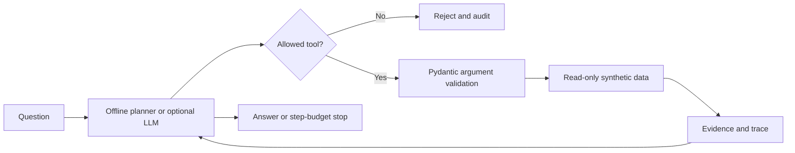

# Switchboard

[](https://github.com/Swakie35/switchboard/actions/workflows/ci.yml)

**A small, inspectable agent runtime where tools are allowlisted, requests have a step budget and evidence remains visible.**

A tool-calling demo is much more convincing to me when the model cannot quietly invent an API, modify records, or loop indefinitely. Switchboard is an operations analyst over invented stock, sales and policy fixtures. It has two ways to run: a deterministic offline planner for testing, and an **optional real OpenAI function-calling adapter**. Both go through the same read-only tool registry and bounded execution loop.

## What works
- Read-only tools for low-stock lookup, policy evidence and 1–30-day sales summaries
- Pydantic input schemas rejecting unexpected arguments; an explicit approved-tool registry
- Step budget, blocked unknown tools, persisted audit traces with request IDs and source references
- FastAPI `POST /ask`, `GET /runs/{id}` and `/health`
- Unit tests exercising the offline agent, tool safety, loop bounds, audit and HTTP integration

## Run without an API key
```bash
python -m venv .venv && source .venv/bin/activate
pip install -e '.[test]'
python -m switchboard --question 'Which items need restocking?'
pytest -q
uvicorn switchboard.api:app --reload
```
Try the API at `http://127.0.0.1:8000/docs`, posting `{"question":"What is the returns policy?","mode":"offline"}`.

## Optional real tool-calling mode
```bash
pip install -e '.[llm]'
export OPENAI_API_KEY='YOUR_KEY_FROM_YOUR_OWN_ENVIRONMENT'
export SWITCHBOARD_MODEL='gpt-4o-mini'
python -m switchboard --mode llm --question 'Which items are below their reorder point?'
```
This invokes an actual model and may incur provider costs. The demo and tests do **not** need it; model availability, cost and behaviour depend on your own account. Never put keys in the repository.



## Honest limitations
The offline planner is rule-based, **not** an LLM. The optional LLM mode has bounded execution but model-generated final prose is not mathematically verified against the evidence; a production release would require answer validation, tenant-level authorization, budget ceilings, prompt-injection evaluation, redaction, user authentication, concurrency control and secret handling. The audit DB stores questions and should not be exposed as a public service. There are no writes to operational systems and no external data integrations.
